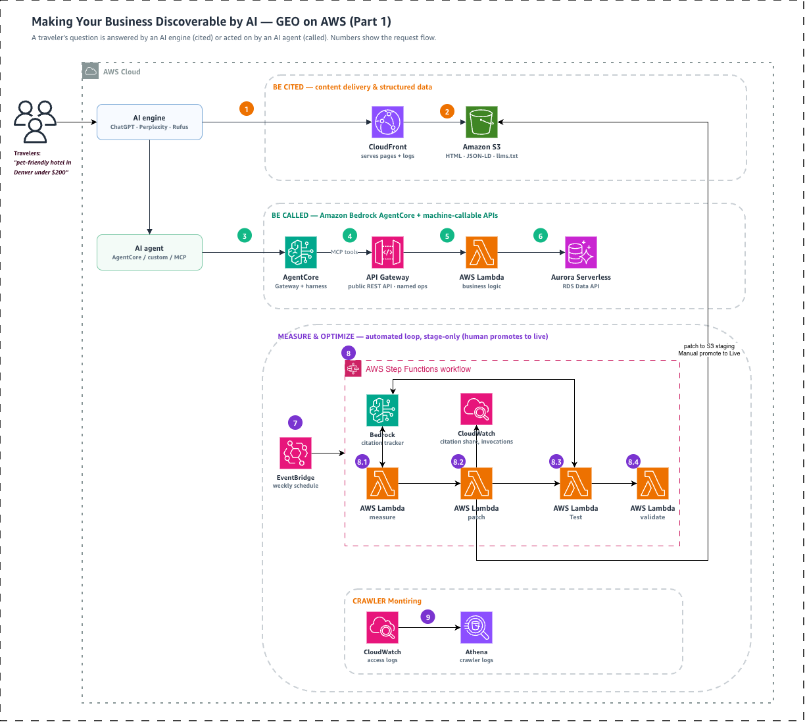

# generative-engine-optimization-aws

AWS CDK (TypeScript) infrastructure for the **Octank Hospitality** platform — a
Generative Engine Optimization (GEO) demo for a hotel-booking system. External
AI engines (ChatGPT, Perplexity, Amazon Rufus, …) and browsers reach a
single-page app and a public REST API; the API queries an Aurora database, and a
set of worker Lambdas run a content feedback loop. The app is organized as a set
of small, single-responsibility stacks so each component can be built out and
deployed independently.

The design follows the GEO blog's two levels of AI discoverability — **be
cited** (serve structured, crawlable content) and **be called** (expose
machine-callable APIs for agents) — plus a measurement loop that tracks citation
share and stages fixes.

📚 **Documentation:** [technical layers](docs/LAYERS.md) ·
[architecture decisions](docs/ADR.md) · [docs index](docs/README.md)

## Architecture



An AI engine or browser reaches the site and API through **Amazon CloudFront**
(`EdgeStack`). The default behavior serves the SPA and structured content
(HTML + JSON-LD, `llms.txt`, `robots.txt`) from a private **Amazon S3** bucket
via Origin Access Control; the `/api/*` behavior routes to a public **Amazon API
Gateway** REST API (`ComputeStack`). The API's `api-handler` **AWS Lambda**
queries **Amazon Aurora PostgreSQL Serverless v2** (`DatabaseStack`) over the
**RDS Data API**. Three worker Lambdas run the GEO feedback loop — a
`citation-tracker` (Amazon Bedrock), a `patch-applier` (writes candidates to
`staging/`), and a `promoter` (stage-only validation) — orchestrated by an **AWS
Step Functions** state machine (`WorkflowStack`). **Amazon Athena** over
CloudFront logs (`AnalyticsStack`) and VPC Flow Logs (`MonitoringStack`) provide
measurement.

For a layer-by-layer deep dive, see **[docs/LAYERS.md](docs/LAYERS.md)**. For
request/feedback-loop flows and cross-stack cycle avoidance, see
**[docs/ARCHITECTURE.md](docs/ARCHITECTURE.md)**.

## Stacks

| Stack             | Component            | Status | Responsibility                                   |
| ----------------- | -------------------- | ------ | ------------------------------------------------ |
| `NetworkStack`    | VPC                  | ✅ done | Subnets, NAT, security groups, VPC endpoints |
| `StorageStack`    | S3                   | ✅ done | Single bucket (`web_application/`, `code/`, `logs/`, `staging/`) + asset upload |
| `DatabaseStack`   | Aurora               | ✅ done | Serverless v2 cluster + Secrets Manager creds    |
| `ComputeStack`    | Lambda + API         | ✅ done | 4 VPC Lambdas + public REST API (Octank Hospitality) |
| `EdgeStack`       | CloudFront           | ✅ done | SPA via S3 (OAC) + `/api/*` to API, access logs  |
| `AnalyticsStack`  | Athena               | ✅ done | Glue DB + EXTERNAL table + workgroup over `logs/cf_logs/` |
| `WorkflowStack`   | Step Functions       | ✅ done | GEO feedback-loop state machine (3 worker Lambdas) |
| `MonitoringStack` | CloudWatch / S3 logs | ✅ done | Logging module: VPC Flow Logs → S3 `logs/vpc_flow/` |
| `AiStack`         | Bedrock AgentCore    | ⚠️ synth-only | AgentCore Gateway + managed Harness concierge (not yet live-verified) |
| `ConciergeChatStack` | API GW + Lambda + DynamoDB | ⚠️ synth-only | Public async submit/poll chat API fronting the harness |

Each stack composes a matching reusable construct from `lib/constructs`.
Deep-dive details for every layer are in **[docs/LAYERS.md](docs/LAYERS.md)**.

## Project layout

```
bin/app.ts            CDK app entry point — instantiates + wires all stacks
lib/config/           Central config: defaults + CDK-context overrides + validation
lib/stacks/           One stack per component (ten stacks; ai + concierge-chat synth-only)
lib/constructs/       Reusable L3 constructs, one per component
assets/               Content uploaded to S3: web_application/, code/ (Lambdas), db/ (DDL+seed)
test/unit/            Jest synthesis tests (fast, no AWS calls)
test/integration/     Jest tests against deployed resources (self-skip w/o env)
docs/                 Technical documentation (layers, ADRs, architecture, deployment, config, security)
cdk.json              CDK app command + feature flags
```

## Prerequisites

- Node.js 20+ (developed on 24)
- AWS credentials configured (`aws sts get-caller-identity` should succeed)
- CDK bootstrapped in the target account/region:
  `npx cdk bootstrap aws://<account>/<region>`
- For the citation tracker / AgentCore: **Amazon Bedrock model access** enabled
  for the configured model in your region.

## Quick start

```bash
npm install                 # install dependencies
npm run build               # type-check (tsc --noEmit)
npm run test                # unit tests (synthesis assertions)
npm run synth               # cdk synth --strict (all stacks)
npm run deploy -- --all     # deploy every stack
```

> **Two-phase first deploy.** The `promoter` Lambda and SPA cache invalidation
> need the CloudFront `distributionId`, which doesn't exist until `EdgeStack` is
> created. Deploy once, read the `DistributionId` from the EdgeStack output,
> then redeploy Storage + Compute with it:
>
> ```bash
> npm run deploy -- --all
> DIST_ID=$(aws cloudformation describe-stacks --stack-name geo-demo-dev-edge \
>   --query "Stacks[0].Outputs[?OutputKey=='DistributionId'].OutputValue" --output text)
> npm run deploy -- geo-demo-dev-storage geo-demo-dev-compute -c distributionId=$DIST_ID
> ```
>
> See [ADR-0005](docs/ADR.md) for why. Full deploy order and teardown are in
> [docs/DEPLOYMENT.md](docs/DEPLOYMENT.md).

## Testing

Two tiers (see [ADR-0007](docs/ADR.md)):

### Unit tests — no AWS, no deploy

Synthesize the stacks in memory and assert on the CloudFormation templates.
Fast, free, and CI-safe.

```bash
npm run test        # or: npm run test:unit
```

### Integration tests — against a live deployment

Hit the deployed endpoints and assert on real responses. Organized around the
blog's business scenario (a traveler asks an AI to *"find a pet-friendly hotel
in Denver this weekend under $200 and book it"*), with one file per GEO layer:

| File | Layer | Covers |
|------|-------|--------|
| `foundation.integ.test.ts` | Be cited | `llms.txt`, `robots.txt` AI crawlers, `sitemap.xml`, LodgingBusiness JSON-LD, security headers |
| `agentic.integ.test.ts` | Be called | `searchProperties` → `getAvailability` → `getRates` → `createReservation` idempotency, typed inputs, structured errors |
| `measurement.integ.test.ts` | Measure | Athena crawler query, Step Functions feedback loop, stage-only IAM guarantee, (Bedrock citation tracker — gated) |

Each `describe` block **self-skips** when its required env vars are unset, so the
suite stays green in CI without a deployment.

```bash
# 1. Deploy, then point the tests at the deployment:
export BLOG_URL="https://$(aws cloudformation describe-stacks \
  --stack-name geo-demo-dev-edge \
  --query "Stacks[0].Outputs[?OutputKey=='DistributionDomainName'].OutputValue" \
  --output text)"

# 2. (Optional) enable the measurement-layer checks:
export ATHENA_WORKGROUP="geo-demo-dev-analytics"
export ATHENA_DATABASE="geo_demo_dev_logs"
export STATE_MACHINE_ARN="arn:aws:states:<region>:<acct>:stateMachine:geo-demo-dev-feedback-loop"
export CONTENT_BUCKET="geo-demo-dev-content-<acct>-<region>"

# 3. Run the integration suite:
npm run test:integ
```

The full env-var reference and the Bedrock-gated test are documented in
[`test/integration/README.md`](test/integration/README.md).

## Configuration

A single environment (`dev`). All configuration is **centralized** in
[`lib/config/index.ts`](lib/config/index.ts) — one source of truth. Each tunable
has a default that you can **override at deploy time via CDK context**
(`-c key=value`) without editing source; overrides are validated and fail fast
at synth. Account/region resolve from the CDK CLI environment or the
`CDK_DEPLOY_ACCOUNT` / `CDK_DEPLOY_REGION` vars.

```bash
# Use defaults
npm run deploy -- --all

# Bring your own CIDR and full-HA NAT
npm run deploy -- --all -c cidr=10.42.0.0/16 -c maxAzs=2 -c natGateways=2
```

The complete reference — every context key, default, and validation rule — is in
**[docs/CONFIGURATION.md](docs/CONFIGURATION.md)**.

## Compliance

`bin/app.ts` applies cdk-nag's `AwsSolutionsChecks` at synth time. Findings are
resolved or carry documented `NagSuppressions`; see
[docs/SECURITY.md](docs/SECURITY.md).

## Documentation

| Document | What's inside |
| -------- | ------------- |
| [docs/LAYERS.md](docs/LAYERS.md) | Per-layer technical deep-dive (Network, Storage, Database, Compute, Edge, Workflow, Logging, Analytics, AI, Chat) |
| [docs/ADR.md](docs/ADR.md) | Architecture decision records |
| [docs/ARCHITECTURE.md](docs/ARCHITECTURE.md) | System overview, request + feedback-loop flows, cross-stack references, deploy order |
| [docs/DEPLOYMENT.md](docs/DEPLOYMENT.md) | Prerequisites, bootstrap, deploy order, verification, teardown, troubleshooting |
| [docs/CONFIGURATION.md](docs/CONFIGURATION.md) | Complete config reference |
| [docs/SECURITY.md](docs/SECURITY.md) | Network isolation, IAM least-privilege, encryption, cdk-nag baseline |
| [docs/ADAPTING.md](docs/ADAPTING.md) | What to keep vs. adapt for your own business |
